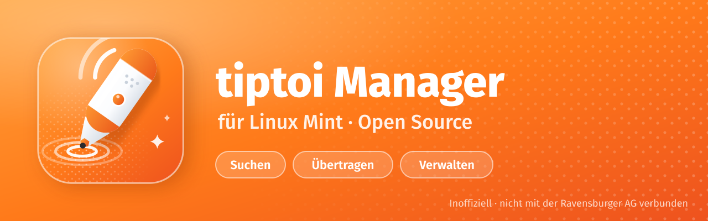

# tiptoi Manager für Linux Mint



Eine kleine Desktop-App (Python + GTK 3) für den tiptoi-Stift. Python + GTK 3 ist unter Linux Mint vorinstalliert.

## Was die App kann

- **Gerät**: erkennt den angeschlossenen Stift automatisch. Sie zeigt Modell, Seriennummer und freien Speicher als Balken (orange ab 85 %, rot ab 95 %). Über **Auswerfen** wird der Stift sicher getrennt.
- **Suche wie bei Google**: großes Suchfeld auf der Startseite mit Live-Vorschlägen beim Tippen. Die Vorschläge kommen aus Titeln, Wortergänzung und deinem Suchverlauf. **Enter** startet die Suche.
  - Treffer zeigen Vorschaubild, Titel, Beschreibung und Version. Die Suchbegriffe sind fett hervorgehoben.
  - Über der Liste steht „Ungefähr N Ergebnisse (0,01 Sekunden)“. Bei Tippfehlern erscheint „Meintest du: …“.
  - Mit „Auf gut Glück!“ öffnest du einen zufälligen Titel.
  - Umlaute sind egal: *märchen*, *maerchen* und *Marchen* finden dasselbe.
- **Auf den Stift**: lädt die .gme-Datei direkt vom Ravensburger-Server. Sie wird mit Fortschrittsbalken übertragen. Vorher prüft die App den freien Platz, und die Datei wird erst als Zwischendatei geschrieben. So entsteht keine halbe Datei, wenn etwas schiefgeht.
- **Auf dem Stift**: zeigt alle installierten Inhalte: Bücher/Spiele (.gme), Hörbücher und Lieder (.rav). Du siehst Größe, Version und Produkt-ID. Du kannst die Inhalte filtern, **deinstallieren** und **aktualisieren**, wenn eine neuere Version im Katalog ist. Mit „Alle aktualisieren“ geht das in einem Schritt.

## Installation

```bash
git clone https://github.com/hubelbubel/linux-tiptoi-manager.git
cd linux-tiptoi-manager
./install.sh
```

Danach findest du **tiptoi Manager** im Startmenü. Du kannst ihn auch im Terminal mit `tiptoi-manager` starten.
Falls das Skript meldet, dass Python-GTK fehlt (bei Mint eigentlich nie):
`sudo apt install python3-gi gir1.2-gtk-3.0`

## Aktualisieren

```bash
cd ~/Projekte/linux-tiptoi-manager   # dort, wo du das Repo geklont hast
git pull
./install.sh
```

Danach die App neu starten. Deine Einstellungen, der Suchverlauf und die Inhalte auf dem Stift bleiben erhalten.

Deinstallieren: `./uninstall.sh`

Ohne Installation testen: `python3 tiptoi_manager.py`

## Bedienung

1. Stift einschalten und per USB anschließen. Mint hängt ihn automatisch ein, die App zeigt ihn oben an.
2. Suchbegriff tippen, z. B. „Bauernhof“. Mit Enter suchen oder einen Vorschlag anklicken.
3. Beim gewünschten Titel auf **Auf den Stift** klicken.
4. Vor dem Abziehen auf **Auswerfen** klicken.

Tastenkürzel: `Strg+F` Suche · `Strg+1`/`Strg+2` Reiter wechseln · `F5` Geräte neu suchen · `Strg+Q` Beenden

Wird der Stift nicht erkannt (z. B. weil das Laufwerk anders heißt), wähle im Menü (☰) **„Stift-Ordner manuell wählen…“**.

## Woher die Daten kommen

| Was | Quelle |
|---|---|
| Liste aller Audiodateien + Downloads | Offizielle Datei `https://cdn.ravensburger.de/db/tiptoi.csv` (täglich neu geladen) |
| **Vorschaubilder, Titel, Kategorien, Artikelnummern** | Offizielles Serviceportal [service.ravensburger.de → tiptoi® Audiodateien](https://service.ravensburger.de/tiptoi%C2%AE/tiptoi%C2%AE_Audiodateien) (wöchentlich neu geladen) |
| Zusätzliche Beschreibungen | Öffentliche Übersicht `http://tiptoi.vakat.de/` |

Die App liest die Produktseiten des Serviceportals aus. Jede Seite hat ein Produktbild und einen Download-Link. Über den Dateinamen ordnet die App beides dem Katalog zu. Titel, die nur im Portal stehen, kommen zusätzlich in die Suche.

**Erster Start:** Das Auslesen dauert einmalig etwas, je nach Verbindung etwa eine bis wenige Minuten. Den Fortschritt siehst du auf der Startseite. Die Suche funktioniert in der Zeit schon, die Bilder erscheinen danach automatisch. Das Ergebnis wird eine Woche gespeichert. Neu laden geht über das Menü (☰) → **Vorschaubilder neu laden**.

Findet die App für einen Titel kein Bild, zeigt sie eine farbige Kachel mit Initialen.
Downloads kommen immer direkt von Ravensburger. Ist eine Adresse nicht erreichbar, versucht die App automatisch die Adresse aus dem Serviceportal.

Die Adressen lassen sich in `~/.config/tiptoi-manager/config.json` anpassen, falls sich eine Quelle ändert.
Zwischenspeicher: `~/.cache/tiptoi-manager/`. Leeren über das Menü oder durch Löschen des Ordners.

## Gut zu wissen

- **Hörbücher/Lieder (.rav)** sind an deinen Stift lizenziert. Löschst du sie, musst du sie über dein Ravensburger-Konto neu laden. Die App warnt vorher.
- **Firmware-Updates** macht die App bewusst nicht.
- Geprüft wurden die Logik und alle Abläufe mit Testdaten und einem simulierten Stift. Mit einem echten Stift und dem Live-Katalog konnte nicht getestet werden.

## Tests

Die Tests brauchen weder GTK noch Internet noch einen echten Stift:

```bash
python3 tests/test_core.py        # Katalog, Suche, GME-Header, Kopieren auf simulierten Stift
python3 tests/test_portal.py      # Auslesen des Serviceportals mit nachgebauten Seiten
python3 tests/test_gui_smoke.py   # Abläufe der Oberfläche mit einer GTK-Attrappe
```

## Rechtliches

Inoffizielles Werkzeug, nicht mit der Ravensburger AG verbunden. tiptoi® ist eine eingetragene Marke der Ravensburger AG. Lizenz: MIT.
